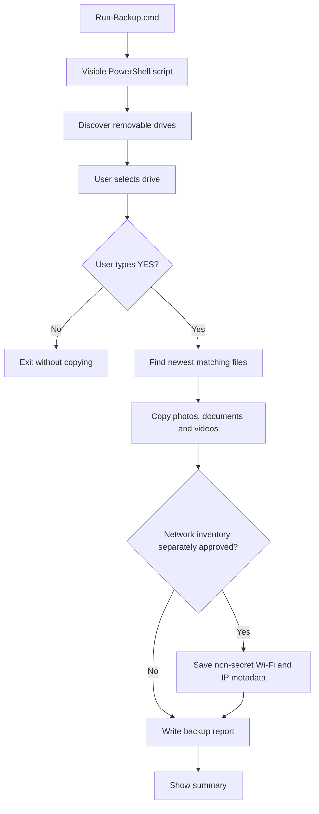

# Architecture

## Main components

- `Run-Backup.cmd`: starts the PowerShell script in a visible console.
- `src/USB-Backup.ps1`: drive selection, confirmation, file discovery, copying, optional network inventory, and reporting.
- `tests/Test-Project.ps1`: repository/source safety checks.
- `defense/`: defensive research notes about the original prototype's behavior and Windows detection/mitigation.
